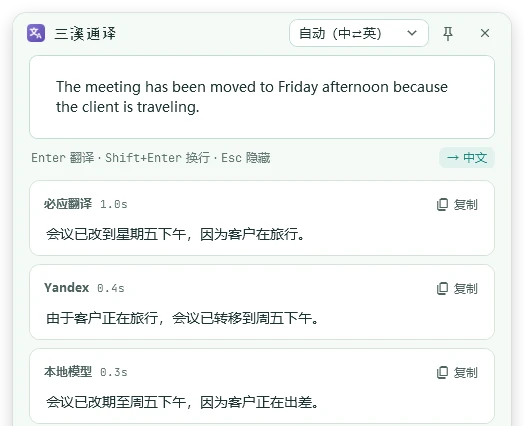
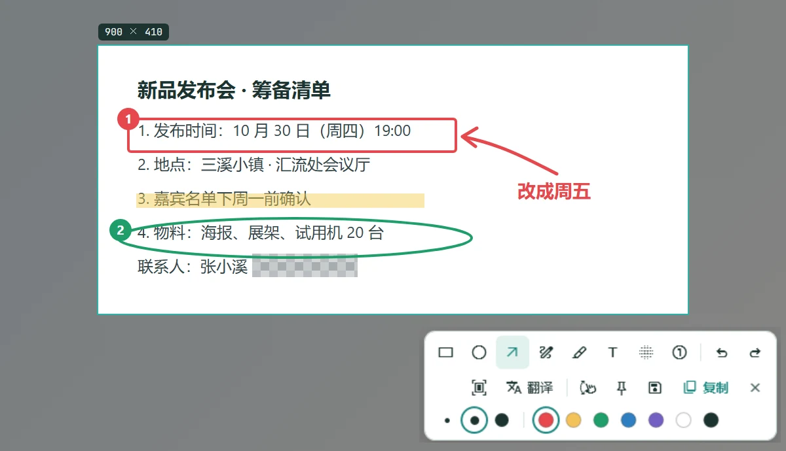
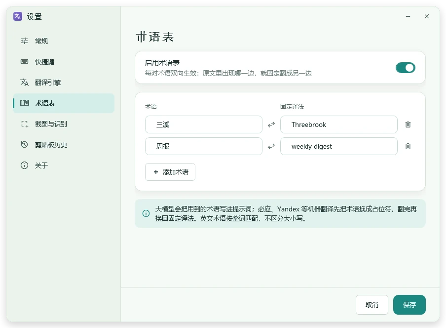
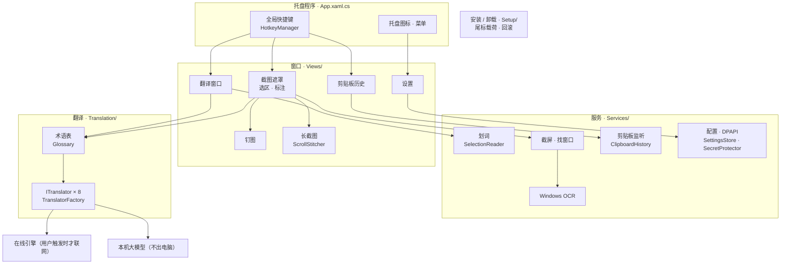
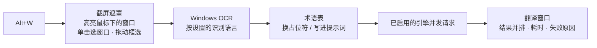
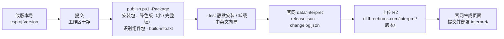

<div align="center">


<h1>三溪通译 · 源代码</h1>

<h3>划一下、截一下，马上就懂。</h3>

<p>常驻托盘的 Windows 翻译小工具——C# .NET 10 WPF，单文件发布，程序本体约 750 KB。</p>


[它做什么](#它做什么) · [现状](#现状) · [架构](#架构) · [代码地图](#代码地图) · [开发](#在-windows-上开发) · [发布](#发布一个新版本) · [用法速查](#用法速查) · [官网](https://interpret.threebrook.com/)



</div>

> [!IMPORTANT]
> **这是三溪通译的源代码仓库，版权归三溪 Threebrook 所有，未经许可不得复制或分发。** 用户下载和介绍在官网 [interpret.threebrook.com](https://interpret.threebrook.com/)（官网在单独的仓库 `Threebrook Web`）。

## 它做什么

看英文资料卡住了、截图里的日文看不懂、要回一封外文邮件——按一下快捷键，译文就出现在旁边。平时安安静静待在托盘里。

| ⌨️ 输入翻译 `Alt+Q` | 🖱️ 划词翻译 `Alt+D` | ✂️ 截图翻译 `Alt+W` |
| --- | --- | --- |
| 打进去回车就翻，中英文自动判断方向。 | 在任何程序里选中文字，按一下就翻（UI Automation 读选区，读不到再模拟复制）。 | 框选屏幕一块区域，Windows 自带 OCR 识别后翻译。 |

另外两个快捷键：`Alt+S` 截图（标注、钉图、长截图、识别文字、复制保存），`Alt+H` 剪贴板历史（文字 + 图片，回车粘贴）。五个快捷键都可以在设置里改成任意组合。

<table>
<tr>
<td width="50%"></td>
<td width="50%"></td>
</tr>
<tr>
<td align="center"><sub>截图标注：8 种工具、钉图、长截图（滚动拼接）</sub></td>
<td align="center"><sub>术语表：双向生效，大模型写进提示词，机器翻译用占位符</sub></td>
</tr>
</table>

**翻译引擎**：必应、Yandex（免 Key，非官方接口，默认开启）；百度、腾讯、有道、Azure、DeepL（官方 API）；OpenAI 兼容接口（本机 Ollama / LM Studio / vLLM，或 DeepSeek 等在线大模型）。可同时开几个，结果并排，最快的先出。

## 现状

<table>
<tr><th>项目</th><th>状态</th></tr>
<tr><td><b>Windows</b></td><td>✅ <b>0.7.0</b>（2026-10-24）：输入 / 划词 / 截图翻译，截图标注、钉图、长截图，剪贴板历史，8 种引擎 + 术语表，API Key DPAPI 加密，Windows OCR，浅色 / 深色，中英文界面，自制安装包和两种绿色版</td></tr>
<tr><td>官网</td><td>✅ interpret.threebrook.com 已做好（中英文：首页、下载、帮助、隐私政策、许可协议），公司主页 threebrook.com 第 5 站“通译小铺”</td></tr>
<tr><td>代码签名</td><td>⏸ 安装包未签名，别的电脑上 SmartScreen 可能提示“未知发布者”，需要代码签名证书</td></tr>
<tr><td>其他平台</td><td>✖ 只做 Windows</td></tr>
</table>

**价格**：免费，可以把未修改的安装包或绿色版分享给别人（见 [`Setup/License.txt`](src/ThreebrookInterpret/Setup/License.txt)）。

## 架构



### 一次截图翻译



## 代码地图

```
publish.ps1                   发布：单文件 exe、-Portable 自带运行时、-Package 安装包和两种绿色版（各有小 / 完整版）+ 识别组件包
src/ThreebrookInterpret/
  App.xaml.cs                 托盘、快捷键、各功能入口；--render-previews、安装 / 卸载模式分流
  AppInfo.cs                  产品名、网址、版本（内部标识一律 ThreebrookInterpret）
  Translation/                翻译引擎：ITranslator 实现，在 TranslatorFactory 注册；Glossary 术语表
  Services/                   快捷键、划词、截屏、OCR、剪贴板历史、配置、DPAPI、开机自启、预览渲染
  Views/                      翻译窗口、截图遮罩与标注、钉图、长截图、剪贴板历史、设置、自绘标题栏
  Setup/                      安装 / 卸载向导与引擎：安装包格式、回滚、快捷方式、卸载信息、许可协议
  Localization/               界面文字 Strings.zh.xaml / Strings.en.xaml（键一一对应）
  Theme/                      浅色 / 深色颜色（由三溪外观规范生成）、字体与图标、控件样式
  Fonts/ Assets/              裁剪后的字体（含许可）、产品图标
tools/
  fonts/build_fonts.py        裁剪站酷小薇 / Bricolage / JetBrains Mono / Material Symbols
  ocr/fetch.ps1               下载高精度识别组件（PaddleOCR 模型 + onnxruntime.dll，校验 SHA256）到 tools/ocr/cache
  IconGen/                    生成产品图标 AppIcon.ico 和预览图
doc/images/                   本 README 用的界面截图（--render-previews 渲染，示例数据）
```

> [!NOTE]
> 不在仓库里的：`dist/`（发布产物）、`doc/01-ui/`（三溪外观规范等设计资料，本机保存）、`bin/` `obj/`。**用户的配置、剪贴板历史和日志在 `%AppData%\ThreebrookInterpret`，开发和测试时都不要动它。**

## 在 Windows 上开发

```powershell
dotnet build src/ThreebrookInterpret -c Debug                       # 编译（需要 .NET 10 SDK）
.\publish.ps1                                                        # dist\ThreebrookInterpret.exe（框架依赖，约 750 KB）
.\publish.ps1 -Package                                               # dist\package：安装包、两种绿色版（各有小 / 完整版）+ 识别组件包 + build-info.txt
ThreebrookInterpret.exe --render-previews <目录>                     # 各窗口 中英文 × 浅深色 渲染成 PNG（屏幕外，不读写用户数据）
```

- **测安装包一律加 `--test`**：换一个 AppId 和名字，不碰开机自启和真实数据。静默装 `Setup.exe --silent --dir <临时目录> --test`，卸 `ThreebrookInterpret.exe --uninstall --silent --test`；`THREEBROOK_SETUP_FAIL_AT=<n>|end` 模拟出错验证回滚，日志在 `%TEMP%\ThreebrookInterpret-Setup.log`。
- **会操作鼠标、键盘的测试先问过再做**；能用 `--render-previews`、`--test` 验证的就不要动真实桌面。
- 绿色版：exe 旁边放一个 `portable` 文件，数据就存到旁边的 `data\`，不写 `%AppData%`。
- 新增标题汉字要加到 `tools/fonts/display-chars.txt`，新增图标加到 `build_fonts.py` 的 ICONS 并在 `Theme/Typography.xaml` 登记，再重跑字体脚本。

## 发布一个新版本



1. 改 `src/ThreebrookInterpret/ThreebrookInterpret.csproj` 的 `<Version>`，提交。`-Package` 要求 `src` 和发布脚本没有未提交的改动，免得安装包里的许可协议和仓库对不上（临时试包加 `-AllowDirty`）。
2. `.\publish.ps1 -Package`，产物和 `build-info.txt`（版本、提交、校验值）在 `dist\package`。识别组件包要先运行一次 `tools\ocr\fetch.ps1`（缓存在 `tools\ocr\cache`，不进仓库），没有缓存时只跳过组件包。
3. 用 `--test` 静默安装、覆盖安装、卸载各走一遍，中英文安装向导各看一次。
4. 官网仓库：`data/interpret/release.json` 写文件名、大小、校验值和下载地址，`changelog.json` 写中英文更新内容；协议有改动时同步 `data/interpret/legal/`。运行 `python tools/gen_interpret_pages.py`。
5. 安装包上传到 R2（`dl.threebrook.com/interpret/<版本>/`），确认能下载、校验值一致后，提交官网仓库并部署 `interpret` 文件夹。R2 只留最新版。

## 用法速查

<details>
<summary><b>快捷键与截图操作</b></summary>

| 快捷键 | 功能 |
| --- | --- |
| `Alt+Q` | 输入翻译 |
| `Alt+D` | 划词翻译（先选中文字） |
| `Alt+S` | 截图：框选后可识别文字、翻译、钉图、复制、保存 |
| `Alt+W` | 截图翻译：框选后直接识别并翻译 |
| `Alt+H` | 剪贴板历史（文字 + 图片），Enter 粘贴 |

- 截图时鼠标移到哪个窗口就高亮它，单击选中该窗口（桌面上单击选中整个屏幕），拖动自由框选；拖边和角调整大小，方向键微调位置，Shift + 方向键调整大小。
- 截图界面：Enter / Ctrl+C 复制，Ctrl+S 保存，F3 钉图，O 识别文字，T 翻译，L 长截图，右键 / Esc 取消。
- 标注工具（数字键 1–8）：矩形、椭圆、箭头、画笔、荧光笔、文字、马赛克、序号；Ctrl+Z / Ctrl+Y 撤销重做；复制、保存、钉图都带标注，识别文字用原图。
- 钉图：拖动移动，滚轮缩放，Ctrl+滚轮调透明度，双击 / Esc 关闭，右键更多操作。
- 钉图选取文字：钉住后在本机自动识别文字，鼠标移到文字上变成 I 形光标，拖动选取（Shift+点击延伸、双击选整行、Ctrl+A 全选），Ctrl+C 或操作条复制、翻译；在文字以外拖动或按住 Ctrl 拖动移动钉图，Esc 先取消选取。

</details>

<details>
<summary><b>翻译引擎、本地大模型与术语表</b></summary>

| 引擎 | 需要 | 说明 |
| --- | --- | --- |
| 必应翻译 | 无 | 网页版接口 `www.bing.com/ttranslatev3`，非官方，默认启用 |
| Yandex | 无 | 安卓客户端接口，非官方，默认启用 |
| OpenAI 兼容接口 | 地址 + 模型名 | 本地 Ollama / LM Studio / vLLM，或 DeepSeek、智谱、硅基流动等在线大模型 |
| 百度、腾讯、有道、Azure、DeepL | 各自的 Key | 官方 API，稳定，有免费额度 |

非官方接口可能随时失效（2026-10 微软 Edge 翻译接口已下线），所以支持同时启用多个引擎。接本地大模型：设置 › 翻译引擎 › 添加 › OpenAI 兼容接口，Ollama 填 `http://localhost:11434/v1`，Qwen3 等推理模型保持“关闭思考模式”（快 2–5 倍）。

术语表：成对的词双向生效；大模型把用到的术语写进提示词，机器翻译先换成占位符、翻完换回；英文按整词匹配、不区分大小写，长的优先。

</details>

<details>
<summary><b>文字识别、界面语言、数据位置</b></summary>

- OCR 默认用 Windows 自带识别，离线、不增加体积，默认跟随系统语言；日、韩、泰等要在 Windows 语言设置里添加该语言（勾选“光学字符识别”），再在 设置 › 截图与识别 里选择。
- 高精度识别（可选组件，约 37 MB，zip 约 24 MB）：PaddleOCR PP-OCRv5 mobile + ONNX Runtime，同样本机识别、不联网，中文屏幕小字基本不出错（Windows 自带识别在深色底、小字号上错字很多）。两种拿法：用完整版安装包 `ThreebrookInterpret-Setup-<版本>-Full.exe`（约 25 MB）或完整版绿色版 `…-Portable-Full.zip`（约 25 MB）/ `…-Portable-Runtime-Full.zip`（约 93 MB），组件在程序旁边的 `ocr\`，装好、解压就能用；或者小安装包 / 绿色版的用户从官网下载 `ThreebrookInterpret-OcrPack-<版本>.zip`，在 设置 › 截图与识别 点“从文件安装”，装到数据目录的 `ocr\`。完整版和小安装包互相覆盖安装时，`ocr\` 跟着清单增删。识别引擎选“自动”时装了就用它。速度：几行字约 0.5 秒，整屏 1080p 约 6 秒（2.1GHz 至强 4 线程）。
- 界面语言：简体中文 / English，设置 › 常规 里切换，立即生效；默认跟随 Windows 显示语言。新增界面文字两个文件都要加，XAML 用 `{DynamicResource S.键}`，代码用 `Loc.T("键")` / `Loc.F("键", 参数)`。
- 数据：`%AppData%\ThreebrookInterpret\`（绿色版在程序旁边的 `data\`）——`settings.json`（API Key DPAPI 加密）、`history\`（剪贴板历史，默认 500 条 / 30 天）、`error.log`。截图默认保存到 `图片\三溪通译`。
- 从旧版 ThreeBrookTrans 升级：第一次启动时把 `%AppData%\ThreeBrookTrans` 整体迁移过来，开机自启改指向新程序。

</details>

## 约束

> [!WARNING]
> 改代码前必须遵守：
> 1. **只在用户翻译时联网**：没有遥测、统计、自动更新检查；安装、卸载不联网。
> 2. **内部标识一律 `ThreebrookInterpret`**（程序文件名、数据目录、开机自启注册表值、互斥体名），改了会让已有配置和自启失效。
> 3. **不碰用户数据**：开发和测试不清空、不改写 `%AppData%\ThreebrookInterpret`；测试用临时目录和 `--test`。
> 4. API Key、密钥用 DPAPI 加密保存，不写日志、不明文落盘。
> 5. 界面文字只放在 `Strings.zh.xaml` / `Strings.en.xaml`，颜色一律 DynamicResource，按三溪外观规范（产品色暮紫 `#7460C4`）。

## 协作约定

- 注释、提交说明用中文；注释密度和命名跟周围代码一致。
- 只在需要时提交；`doc/01-ui/` 和 `dist/` 不进仓库。
- PowerShell 5.1：含中文的 `.ps1` 要带 UTF-8 BOM；改含中文的 `.csproj` 用 Python 或编辑工具，不用 PowerShell。

---

<div align="center">

<picture>
  <source media="(prefers-color-scheme: dark)" srcset="https://threebrook.com/lockup-dark.svg">
  
</picture>

<sub>© 2026 三溪 Threebrook · 珠海三溪科技有限公司 · support@threebrook.com<br>未经许可不得复制或分发</sub>

</div>
